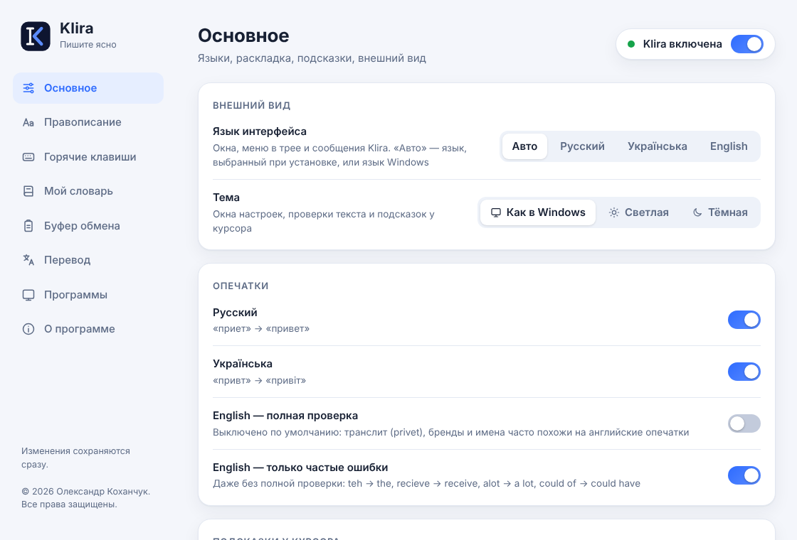
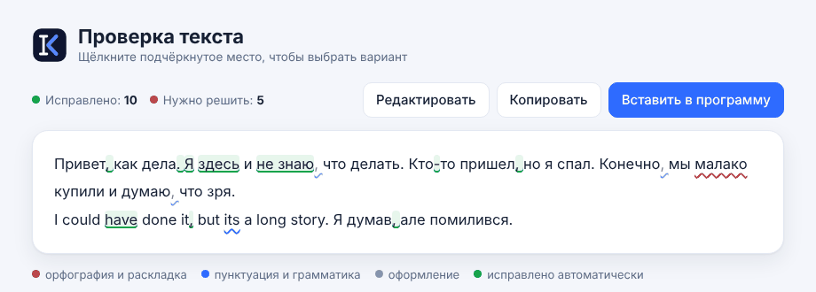
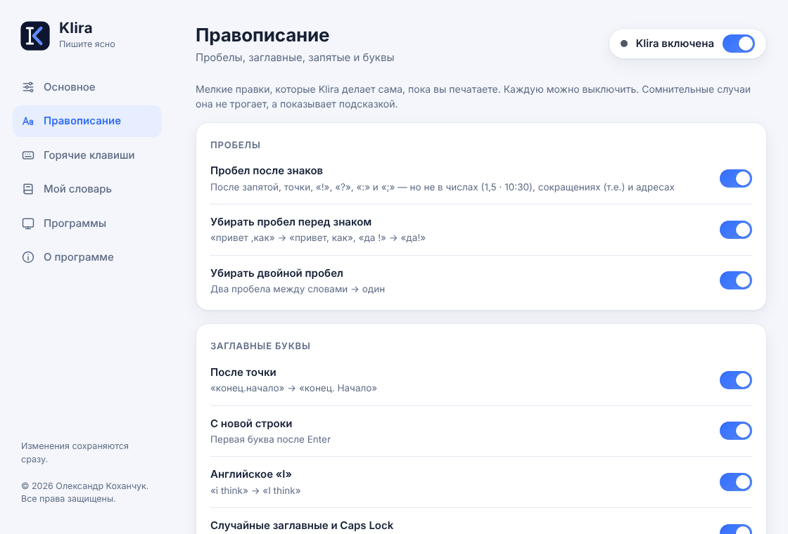
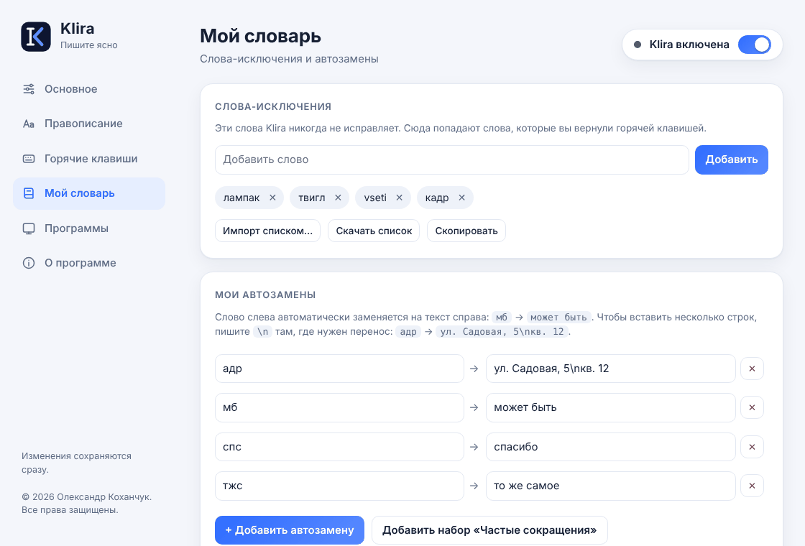
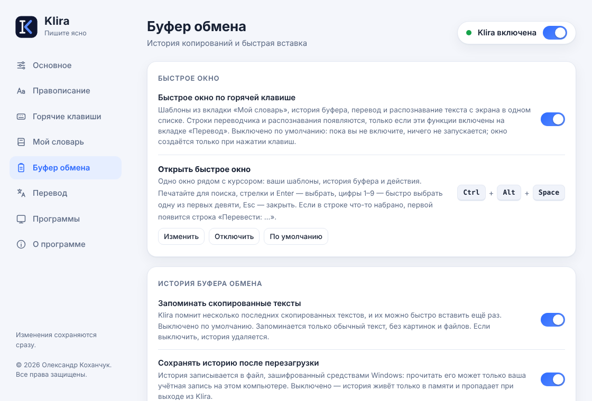
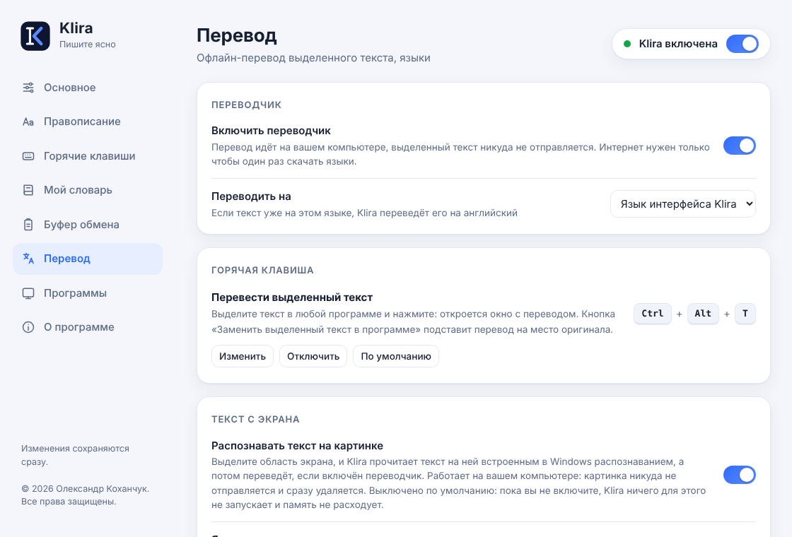
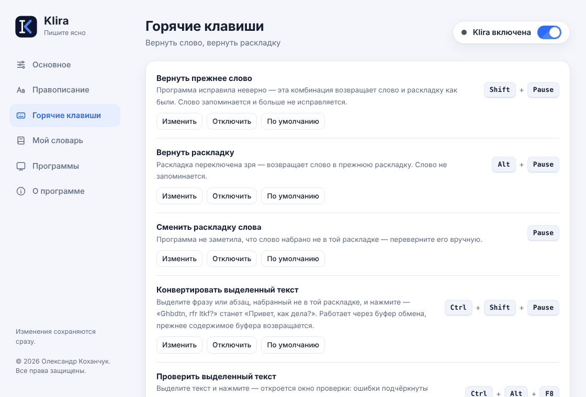
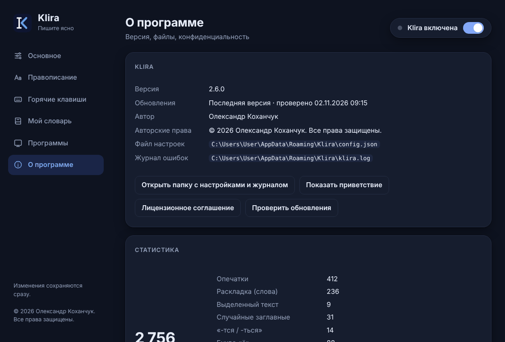

<div align="center">


# Klira

**Пишите ясно.** Автоисправление опечаток и раскладки для Windows: русский, українська, English.

Живёт в трее, работает прямо во время набора, на вашем компьютере и без интернета.

А ещё: умные шаблоны, офлайн-переводчик, текст с экрана (OCR) и быстрое окно с шаблонами, историей буфера и переводом. Всё лишнее выключено по умолчанию, включаете только то, что нужно.

[](https://github.com/VizitSpace/klira/raw/main/downloads/Klira_Setup_2.12.0.exe)

[](https://github.com/VizitSpace/klira/releases/latest)


[Видео](#-видеообзор) · [Установка](#-установка) · [Что умеет](#-что-умеет) · [Горячие клавиши](#-горячие-клавиши) · [Приватность](#-приватность) · [Вопросы и ответы](#-вопросы-и-ответы) · [Проверка файла](#-как-проверить-что-файл-настоящий)

</div>

---

## ▶️ Видеообзор

Подробный обзор основных функций: каждая настройка и живой пример (записан для версии 2.8; что появилось позже, описано ниже).

<div align="center">

[](https://youtu.be/fN-TwbCvxA4)

[**▶ Смотреть на YouTube**](https://youtu.be/fN-TwbCvxA4)

</div>

## ✨ Что умеет

Вы печатаете как обычно, Klira исправляет за вами в момент, когда слово закончено (пробел, Enter или знак препинания).

| Вы печатаете | Получаете |
|---|---|
| `приет ` · `зделать ` · `alot ` | `привет ` · `сделать ` · `a lot ` |
| `ghbdtn ` (забыли переключить раскладку) | `привет `, раскладка переключится сама |
| `привет,как дела` · `конец.начало` | `привет, как дела` · `конец. Начало` |
| `это - тест` · `i think` · `пРИВЕТ` | `это — тест` · `I think` · `Привет` |
| `он делаться ` · `ихний дом` *(этап 2)* | `он делается ` · `их дом` |
| `письмо ` *(своя автозамена с шаблоном)* | готовое письмо с сегодняшней датой, курсор на нужной строке |

Ниже всё, что умеет Klira, от первых версий до последней: раскройте нужный раздел. Пометка **по желанию** значит, что функция выключена по умолчанию и включается на своей вкладке в настройках: так Klira не тратит память на то, чем вы не пользуетесь.

<details open>
<summary><b>🔤 Исправление при наборе</b> — опечатки, раскладка, знаки, грамматика</summary>

<br>

- **Опечатки.** Русский, украинский, английский. Если вариантов несколько, Klira предлагает их подсказкой. *(основа)*
- **Раскладка.** Слово, набранное не в той раскладке, исправляется, и раскладка переключается сама. Короткие слова («не», «да») переключаются вместе со следующим. *(основа)*
- **Пробелы и заглавные.** Пробел после знаков, без пробела перед знаком и без двойных; заглавная после точки и с новой строки; «i» → «I»; «ПРивет» и Caps Lock. *(основа)*
- **Знаки и стиль.** Запятые и дефисы по надёжным правилам, тире, кавычки-«ёлочки», многоточие, буква «ё». *(основа)*
- **Грамматика.** «-тся» и «-ться», «не» с глаголами. *(основа)*
- **Грамматика, этап 2.** «ихний» → «их», «по приезду» → «по приезде», «слідуючий» → «наступний», «irregardless» → «regardless». Спорные случаи не трогаются. **по желанию** · *2.11*
- **Подсказки у курсора.** Если Klira не уверена, рядом с курсором окошко с вариантами: щёлкните или нажмите `Tab`. *(основа)*
- **Подсказки слов.** Как на телефоне: набрали начало слова, и появляются до трёх продолжений, `Tab` принимает первое. 17 языков, набранный текст не запоминается. *2.8*

</details>

<details>
<summary><b>✍️ Свои слова и шаблоны</b> — исключения, автозамены, умные шаблоны</summary>

<br>

- **Слова-исключения.** Эти слова Klira никогда не исправляет. Слово, которое вы вернули горячей клавишей, запоминается само. *(основа)*
- **Автозамены.** «мб» → «может быть»; готовые наборы, импорт и экспорт списком. *(основа)*
- **Умные шаблоны.** В автозамене работают `{дата}`, `{время}`, `{год}`, `{буфер}` и `{курсор}`: слово «письмо» превращается в готовое письмо с сегодняшней датой. **по желанию** · *2.11*

</details>

<details>
<summary><b>✋ Вручную</b> — горячие клавиши для выделенного текста</summary>

<br>

- **Вернуть** прежнее слово или раскладку, если Klira ошиблась. *(основа)*
- **Перевернуть** последнее слово в другую раскладку. *(основа)*
- **Конвертировать выделенный текст** в другую раскладку. *(основа)*
- **Сменить регистр** выделенного: строчные → ПРОПИСНЫЕ → Как в предложении. *(основа)*
- **Проверить выделенное** в отдельном окне: исправленное зелёным, спорное подчёркнуто. *(основа)*

Все комбинации можно поменять, список в разделе [«Горячие клавиши»](#️-горячие-клавиши).

</details>

<details>
<summary><b>🧰 Инструменты</b> — буфер обмена, переводчик, текст с экрана, быстрое окно</summary>

<br>

- **История буфера.** Последние скопированные тексты: поиск, закрепление, вставка цифрами 1–9, шифрованное сохранение после перезагрузки. Пароли и номера карт не запоминаются. **по желанию** · *2.9*
- **Офлайн-переводчик.** `Ctrl+Alt+T`: перевод выделенного на русский, украинский, английский и ещё около 55 языков прямо на вашем компьютере. **по желанию** · *2.10*
- **Быстрое окно.** `Ctrl+Alt+Пробел`: шаблоны, история буфера, перевод и распознавание текста с экрана в одном списке рядом с курсором. **по желанию** · *2.11*
- **Текст с экрана (OCR).** `Ctrl+Alt+O`: выделяете область экрана, Klira читает текст встроенным в Windows распознаванием и переводит. Картинка нигде не сохраняется. **по желанию** · *2.11*

</details>

<details>
<summary><b>🛡 Удобство и защита</b> — программы, паузы, пароли, обновления, интерфейс</summary>

<br>

- **Своя раскладка для программы.** Например, украинская для Telegram, русская для браузера. *(основа)*
- **Паузы и игры.** Пауза на 15 минут, час или до завтра; в играх и полноэкранных программах Klira молчит сама. *(основа)*
- **Что не трогает.** Адреса сайтов, почту, пути, числа, сокращения (`т.д.`), слова с дефисом, ЗАГЛАВНЫЕ аббревиатуры, терминалы и редакторы кода. *(основа)*
- **Защита паролей.** В полях пароля Windows и в окнах от имени администратора Klira молчит. *(основа)*
- **Установщик и обновления.** Установка без прав администратора; раз в сутки Klira сообщает о новой версии и показывает, что в ней нового. *2.6*
- **Три языка интерфейса.** Русский, українська, English; выбирается при установке и в настройках. *2.7*
- **Резервная копия.** Один файл для переноса на другой компьютер или на случай, если ПК сломался. Сами выбираете, что в него войдёт: настройки, словарь, история буфера, закреплённые тексты. Можно защитить паролем (AES-256). «О программе → Резервная копия». *2.7, полная копия с историей и паролем: 2.12*
- **Тема и звук.** Светлая, тёмная или как в Windows; короткий звук при исправлении (по желанию). *(основа)*

</details>

## 🖼 Как это выглядит

<details>
<summary><b>Показать скриншоты</b></summary>

<table>
<tr>
<td width="50%"><br><sub><b>Основное:</b> языки, раскладка, подсказки, тема</sub></td>
<td width="50%"><br><sub><b>Проверка текста:</b> ошибки подчёркнуты, исправленное зелёным</sub></td>
</tr>
<tr>
<td width="50%"><br><sub><b>Правописание:</b> каждое правило можно выключить, грамматика этап 2</sub></td>
<td width="50%"><br><sub><b>Мой словарь:</b> слова-исключения, автозамены и умные шаблоны</sub></td>
</tr>
<tr>
<td width="50%"><br><sub><b>Буфер обмена:</b> быстрое окно и история</sub></td>
<td width="50%"><br><sub><b>Перевод:</b> офлайн-переводчик и текст с экрана</sub></td>
</tr>
<tr>
<td width="50%"><br><sub><b>Горячие клавиши:</b> любые можно поменять</sub></td>
<td width="50%"><br><sub><b>Тёмная тема:</b> светлая, тёмная или как в Windows</sub></td>
</tr>
</table>

</details>

## 📥 Установка

**Вариант 1. Установщик (рекомендуется)**

1. Скачайте [**Klira_Setup_2.12.0.exe**](https://github.com/VizitSpace/klira/raw/main/downloads/Klira_Setup_2.12.0.exe). Это один файл, больше ничего не нужно. Он подходит для 64-разрядной и 32-разрядной Windows и для компьютеров на ARM (Snapdragon, Surface): подходящую версию установщик выберет сам.
2. Запустите его, выберите язык (русский, українська или English), примите лицензионное соглашение и нажимайте «Далее». Права администратора не нужны. Выбранный язык станет языком окон и меню Klira (потом его можно сменить в настройках).
3. Значок Klira появится в трее у часов (если не видно, нажмите стрелку `^` рядом с треем). Синяя галочка значит, что работает.

Удаляется как обычная программа: «Параметры Windows → Приложения».

**Вариант 2. Без установки.** Скачайте архив для вашей Windows, **распакуйте его целиком** (не запускайте из окна архива) и запустите `Klira.exe`. Удобно для флешки. Не знаете, какой нужен? Обычно подходит **x64**.

| Ваш компьютер | Архив |
|---|---|
| Обычная 64-разрядная Windows (почти все современные ПК) | [Klira_2.12.0_x64.zip](https://github.com/VizitSpace/klira/raw/main/downloads/Klira_2.12.0_x64.zip) |
| Старая 32-разрядная Windows | [Klira_2.12.0_x86.zip](https://github.com/VizitSpace/klira/raw/main/downloads/Klira_2.12.0_x86.zip) |
| Windows на ARM (Snapdragon, Surface Pro X / Pro 9 5G и т. п.) | [Klira_2.12.0_arm64.zip](https://github.com/VizitSpace/klira/raw/main/downloads/Klira_2.12.0_arm64.zip) |

Узнать свой тип: «Параметры Windows → Система → О системе → Тип системы».

> **Windows показывает синее окно «Windows защитила ваш компьютер»?** Так бывает со всеми программами без платной цифровой подписи. Нажмите **«Подробнее» → «Выполнить в любом случае»**. Подлинность файла можно проверить [по контрольной сумме](#-как-проверить-что-файл-настоящий).

**Для украинского языка** добавьте украинскую раскладку: Параметры → Время и язык → Язык и регион → Добавить язык.

## ⌨️ Горячие клавиши

Все комбинации можно поменять: правый клик по значку в трее → «Горячие клавиши», или в настройках.

| Действие | По умолчанию | Что делает |
|---|---|---|
| Вернуть прежнее слово | `Shift+Pause` | Отменяет последнее автоисправление. Слово запоминается и больше не исправляется |
| Вернуть раскладку | `Alt+Pause` | Отменяет только зря сделанную смену раскладки |
| Сменить раскладку слова | `Pause` | Вручную переворачивает последнее слово |
| Конвертировать выделенное | `Ctrl+Shift+Pause` | Переводит выделенный текст в другую раскладку |
| Проверить выделенное | `Ctrl+Alt+F8` | Открывает окно проверки орфографии и пунктуации |
| Сменить регистр выделенного | `Ctrl+Alt+Pause` | Строчные → ПРОПИСНЫЕ → Как в предложении |
| Открыть историю буфера | `Ctrl+Alt+V` | Окно с последними скопированными текстами (если функция включена) |
| Быстрое окно | `Ctrl+Alt+Пробел` | Шаблоны, история буфера, перевод и OCR в одном списке (включается на вкладке «Буфер обмена»). |
| Текст с экрана | `Ctrl+Alt+O` | Выделить область экрана, распознать текст и перевести (включается на вкладке «Перевод»). |

**Мышь:** левый клик по значку в трее включает и выключает Klira, правый открывает меню.

## 🔒 Приватность

- Набранный текст **не сохраняется, не записывается в журнал и никуда не отправляется.** Klira держит в памяти только текущую строку до курсора и забывает её после Enter, щелчка мыши или смены окна.
- При первом запуске Klira **ничего не делает, пока вы не дадите согласие.** Отозвать его можно в любой момент: «О программе → Удалить все мои данные».
- Обращения к интернету только к GitHub: раз в сутки запрос «какая последняя версия?» и скачивание языков переводчика, если вы нажали «Скачать». В нём нет ваших данных. Выключается в «Настройки → Основное → Запуск». Новая версия скачивается только после вашего нажатия «Обновить сейчас».
- Нет рекламы, нет аналитики. Всё хранится на вашем компьютере: настройки и счётчики исправлений (только числа). Если вы включите историю буфера обмена, скопированные тексты хранятся только у вас, при желании в зашифрованном файле.
- Распознавание текста с экрана (если включено) идёт на вашем компьютере: картинка сразу удаляется, в сеть не уходит. Шаблоны и быстрое окно ничего не отправляют наружу.
- В окнах, запущенных от имени администратора, и в стандартных полях паролей Klira молчит.

Полный текст: [политика конфиденциальности](https://github.com/VizitSpace/klira/blob/main/docs/PRIVACY.md).

## ❓ Вопросы и ответы

<details>
<summary><b>Klira исправила слово зря. Что делать?</b></summary>

Нажмите `Shift+Pause`: слово вернётся как было и больше не будет исправляться. Если зря переключилась раскладка, нажмите `Alt+Pause`. Слова, которые Klira трогать не должна, можно добавить в «Мой словарь».
</details>

<details>
<summary><b>Не работает в одной из программ</b></summary>

Klira не работает в окнах, запущенных от имени администратора (так устроена защита Windows), и по умолчанию отключена в терминалах, редакторах кода и менеджерах паролей. Список исключений можно менять в разделе «Программы». Если проблема в другом, опишите, в какой программе и что вы набирали, в [Issues](https://github.com/VizitSpace/klira/issues).
</details>

<details>
<summary><b>Антивирус ругается на Klira</b></summary>

Klira перехватывает нажатия клавиш, чтобы исправлять текст, поэтому подозрительной её может считать любая защита. Установщик и программа не подписаны платным сертификатом. Убедитесь, что файл скачан отсюда, и [сверьте контрольную сумму](#-как-проверить-что-файл-настоящий).
</details>

<details>
<summary><b>Как узнать о новой версии?</b></summary>

Klira сама проверит раз в сутки и покажет уведомление. Откройте «Настройки → О программе» и нажмите **«Обновить сейчас»**: Klira скачает новую версию, проверит её контрольную сумму, установит и запустится снова. Настройки сохранятся. Версию без установки обновляйте вручную: скачайте новый архив отсюда. Проверку можно выключить в настройках.
</details>

<details>
<summary><b>Как перенести настройки на другой компьютер?</b></summary>

«Настройки → О программе → Сохранить копию» создаёт один файл со всеми настройками, словарём и автозаменами. На новом компьютере: «Восстановить из файла». Согласие на обработку нажатий клавиш в копию не входит, его нужно дать заново.
</details>

<details>
<summary><b>Как сменить язык интерфейса?</b></summary>

«Настройки → Основное → Внешний вид → Язык интерфейса»: русский, українська или English. По умолчанию («Авто») берётся язык, выбранный при установке.
</details>

<details>
<summary><b>Как удалить?</b></summary>

«Параметры Windows → Приложения → Установленные приложения → Klira → Удалить». Установщик предложит удалить и настройки. Версию без установки: закройте Klira через меню значка и удалите папку.
</details>

<details>
<summary><b>Нужен ли интернет?</b></summary>

Нет. Все словари (около 440 тысяч русских, 130 тысяч украинских и 80 тысяч английских слов, плюс списки частых слов ещё для 14 языков) встроены в программу. Интернет нужен только для необязательной проверки обновлений.
</details>

## 🔐 Как проверить, что файл настоящий

Копии Klira на других сайтах могут быть подделкой, скачивайте только отсюда. Контрольные суммы лежат в файле [SHA256SUMS.txt](https://github.com/VizitSpace/klira/raw/main/downloads/SHA256SUMS.txt). Откройте PowerShell в папке с файлом и выполните:

```powershell
Get-FileHash .\Klira_Setup_2.12.0.exe -Algorithm SHA256
```

Результат должен совпасть с суммой из файла.

## 🆕 Что нового

<details>
<summary><b>Показать историю версий</b></summary>

**2.12.0:** полная резервная копия: настройки, словарь, история буфера и закреплённые тексты в одном файле, по желанию с паролем (AES-256). Вы выбираете, что сохранять и что восстанавливать.

**2.11.1:** грамматика, этап 2, теперь и для украинского и английского (один переключатель на вкладке «Правописание»).

**2.11.0:** умные шаблоны (`{дата}`, `{время}`, `{буфер}`, `{курсор}`), распознавание текста с экрана (`Ctrl+Alt+O`), быстрое окно (`Ctrl+Alt+Пробел`) и грамматика этап 2 — всё выключено по умолчанию и включается на своих вкладках; офлайн-переводчик теперь выключен при первой установке.

**2.10.0:** офлайн-переводчик (`Ctrl+Alt+T`, языки скачиваются на вкладке «Перевод»); перед обновлением Klira показывает список изменений новой версии.

**2.9.1:** подсказки и окно истории буфера в Google Chrome, Edge и других программах на движке Chromium теперь появляются рядом с курсором ввода, а не в углу экрана; новая настройка «Сколько секунд держать подсказку» (3–60 с).

**2.9.0:** история буфера обмена (выключена по умолчанию, поиск, закрепление, быстрая вставка, шифрованное сохранение после перезагрузки); ссылки на репозиторий GitHub и на сайт в «О программе».

**2.8.0:** подсказки слов при наборе, как на телефоне (русский, украинский, английский и ещё 14 языков), без запоминания набранного текста.

**2.7.0:** интерфейс на русском, украинском и английском (язык выбирается при установке и в настройках); окно «Что нового» после обновления; резервная копия настроек одним файлом; обновление в один клик; версии для 32-разрядной Windows и для ARM.

**2.6.0:** Klira сообщает о новых версиях (раз в сутки, выключается в настройках), появился установщик. Подробнее и прошлые версии: [выпуски](https://github.com/VizitSpace/klira/releases).

</details>

## 🌐 In English / Українською

<details>
<summary><b>English</b></summary>

**Klira** is a lightweight Windows tray app that fixes typos and wrong keyboard layout as you type, in Russian, Ukrainian and English. It works offline on your PC, with optional offline translation, smart templates, text recognition from the screen and a quick window (everything extra is off by default); typed text is never stored or sent anywhere. Once a day it asks GitHub for the latest version number (can be turned off).

**Install:** download [Klira_Setup_2.12.0.exe](https://github.com/VizitSpace/klira/raw/main/downloads/Klira_Setup_2.12.0.exe), run it and follow the wizard (no admin rights needed). If Windows SmartScreen warns about an unknown publisher, click "More info" → "Run anyway": the app is not code-signed yet. Verify the file with the SHA-256 in `SHA256SUMS.txt`. Requires Windows 10 or 11, 64-bit. The settings interface is currently in Russian.
</details>

<details>
<summary><b>Українською</b></summary>

**Klira** — невелика програма для Windows у треї, яка виправляє помилки друку та неправильну розкладку під час набору: російська, українська та англійська. Працює офлайн на вашому комп'ютері; набраний текст ніде не зберігається й нікуди не надсилається. Раз на добу запитує у GitHub номер останньої версії (можна вимкнути).

**Встановлення:** завантажте [Klira_Setup_2.12.0.exe](https://github.com/VizitSpace/klira/raw/main/downloads/Klira_Setup_2.12.0.exe), запустіть і дотримуйтесь підказок (права адміністратора не потрібні). Якщо SmartScreen попереджає про невідомого видавця, натисніть «Докладніше» → «Все одно виконати»: програма поки не має цифрового підпису. Перевірте файл за SHA-256 у `SHA256SUMS.txt`. Потрібна Windows 10 або 11, 64 біти. Інтерфейс налаштувань поки що російською.
</details>

---

<div align="center">

© 2026 Олександр Коханчук. Все права защищены.

Использование программы — на условиях [лицензионного соглашения](https://github.com/VizitSpace/klira/blob/main/docs/EULA.txt). Исходный код закрыт: в этом репозитории публикуются только готовые выпуски.

Нашли ошибку или есть идея? [Напишите в Issues](https://github.com/VizitSpace/klira/issues)

</div>

## 📚 Словари подсказок

Списки частых слов для подсказок на 14 языках лежат в папке [`dictionaries`](dictionaries) (получены из проекта [wordfreq](https://github.com/rspeer/wordfreq), лицензия [CC BY-SA 4.0](https://creativecommons.org/licenses/by-sa/4.0/)). Лицензия касается только этих файлов, не программы.
